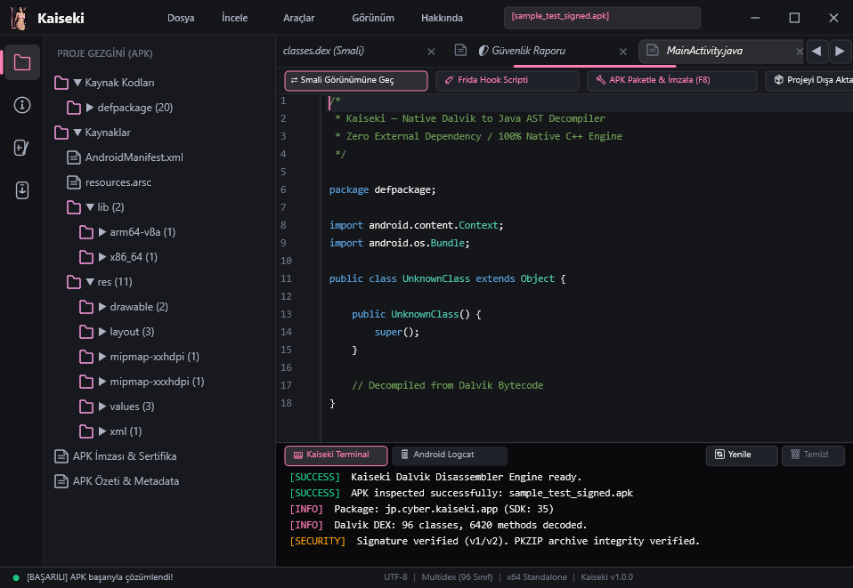
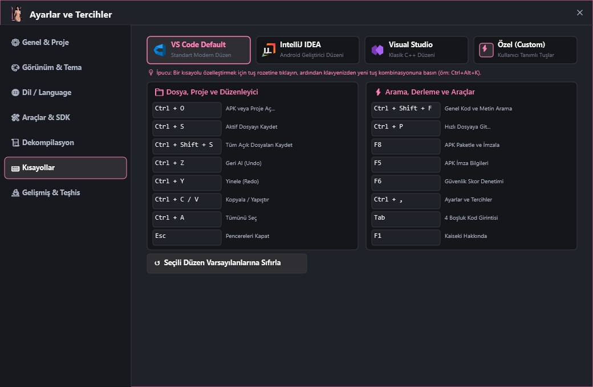
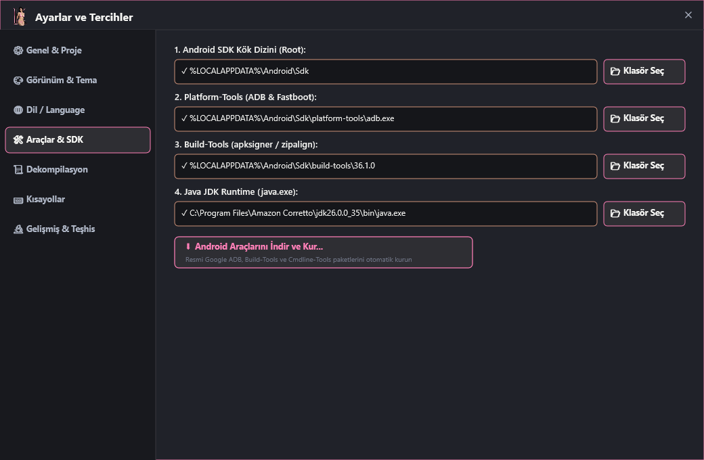
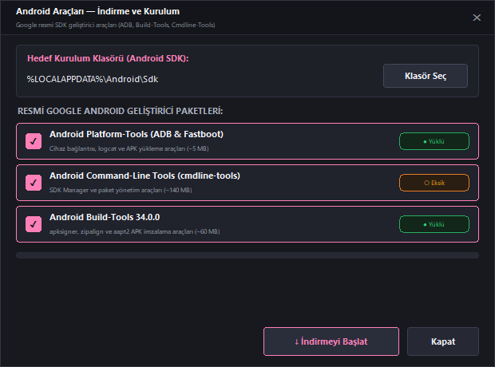

<p align="center">
  
</p>

<h1 align="center">Kaiseki</h1>

<p align="center">
  <b>High-Performance Native Android APK Reverse Engineering, Static Analysis & Security Auditing Platform</b>
</p>

<p align="center">
  <a href="https://github.com/GameSketchers/Kaiseki/releases">
    
  </a>
  <a href="https://github.com/GameSketchers/Kaiseki/releases">
    
  </a>
  <a href="LICENSE">
    
  </a>
  
  
  
</p>

---

## 🌟 Overview

**Kaiseki** (解析) is a lightning-fast, zero-overhead Windows desktop application engineered from scratch in pure native **C++ (C++17)** and hardware-accelerated **Direct2D / DirectWrite**. 

Designed for security researchers, Android reverse engineers, and malware analysts, Kaiseki parses, analyzes, modifies, and repackages Android APK packages **without requiring a Java Runtime Environment (JVM)** for core inspection.

<p align="center">
  
</p>

---

## 🚀 Key Features

### ⚡ 1. Native Dalvik Disassembly & Decompilation (`KaisekiDex`)
- **Multi-DEX AST Engine:** Scans and indexes `classes.dex`, `classes2.dex`, ... `classesN.dex` simultaneously.
- **Bi-Directional View (Smali ⇄ Java):** Seamlessly switch between low-level Dalvik bytecode (`.smali`) and reconstructed high-level Java Abstract Syntax Tree (AST).
- **Sub-Pixel Hardware Editor:** DirectWrite text engine featuring syntax highlighting, line numbering, fast navigation, and zero render latency.

### 📦 2. APK Tree Explorer & Binary XML Decoding (`KaisekiRes`)
- **Memory-Mapped ZIP Engine:** Instant PKZIP decompression with streaming directory indexing.
- **Binary XML Parser (`AxmlEngine`):** Converts compressed binary XML (`AndroidManifest.xml`, layouts, animations) into readable, editable human syntax.
- **ARSC Table Processor:** Full extraction of `resources.arsc` string pools, type specifications, and localized resource configurations.
- **Nested Component Tree:** Hierarchical tree organizing source codes (`defpackage`, `com`, `android`), compiled assets, and native ABI libraries (`arm64-v8a`, `armeabi-v7a`, `x86`, `x86_64`).

### 🛡️ 3. Security Auditing & Vulnerability Scanner (`KaisekiSec`)
- **Automated Risk Scoring:** Evaluates package attack surfaces on a 0–100 security rating scale.
- **Vulnerability Checks:** Automatically flags exported components (`Activity`, `Service`, `BroadcastReceiver`, `ContentProvider`), cleartext HTTP network configurations, `android:debuggable` flags, insecure cryptographic ciphers, and hardcoded API keys.
- **Frida Hook Generator:** Generates custom JavaScript hook scripts for universal SSL Pinning bypass and runtime root detection hooks.

### 🔨 4. Repackaging, 4-Byte Zipalign & Multi-Scheme Signer (`KaisekiCore`)
- **Instant APK Re-Builder:** Compiles modified bytecodes and repackages modified ZIP streams.
- **Native 4-Byte ZipAlign:** Aligns uncompressed assets on 4-byte boundaries for Android runtime execution.
- **Comprehensive Signature Schemes:** Signs APKs using **v1 (JAR)**, **v2 (APK Signing Block)**, and **v3 (Android 9+)** schemes with debug keystores or custom certificates.

### 📱 5. Live ADB Client & Colorized Logcat (`KaisekiADB`)
- **Device Management:** Auto-detects physical Android devices and emulators connected via USB or Wi-Fi.
- **One-Click Deploy (F10):** Direct APK installation and activity launch onto the target device.
- **Real-Time Logcat Terminal:** Low-latency filtered process logs color-coded by log level (Verbose, Debug, Info, Warning, Error).

### 🔍 6. Hex Viewer & Shannon Entropy Analysis (`KaisekiHex`)
- Inspects native ELF shared objects (`.so`) and raw binaries with color-coded hex/ASCII tables.
- Computes cryptographic Shannon entropy to visually identify packed, encrypted, or obfuscated sections.

### ⚙️ 7. Modern Modal Preferences & Custom Keybinding Studio
- **Authentic IDE Presets:** Instant layout switching with vector-crafted branding for **VS Code**, **IntelliJ IDEA**, and **Visual Studio**.
- **Interactive Key Remapping:** Click any of the 16 shortcut badges to capture custom keys (`Ctrl`, `Alt`, `Shift` + key combinations).
- **Privacy by Default:** Dynamic path masking replaces sensitive user profile names with `%LOCALAPPDATA%` and `%USERPROFILE%`.
- **Integrated Tool Installer:** Built-in modal downloader for official Google Android SDK command-line tools, platform-tools, and build-tools.

<p align="center">
  
  
</p>
<p align="center">
  
</p>

---

## 🏛️ Modular Subsystem Architecture

Kaiseki employs a resilient **9-module DLL delay-load architecture** managed by a centralized topological `ModuleManager`:

| Module | File | Responsibility |
|---|---|---|
| **Host Application** | `Kaiseki.exe` | Main shell, CLI dispatch, single-instance mutex, and crash harness |
| **UI Engine** | `KaisekiUI.dll` | Direct2D/DirectWrite rendering, document tabs, modal preferences, and theme manager |
| **Core Subsystem** | `KaisekiCore.dll` | PKZIP streaming, APK compilation, 4-byte zipalign, and crypto signature block |
| **Dalvik Engine** | `KaisekiDex.dll` | Multi-DEX bytecode parser, Dalvik-to-Java AST decompiler, and Smali emitter |
| **Resource Engine** | `KaisekiRes.dll` | Binary XML (`AxmlEngine`) decompiler and `resources.arsc` table decoder |
| **ADB Bridge** | `KaisekiADB.dll` | Native Android Debug Bridge protocol, device daemon client, and live Logcat stream |
| **Security Suite** | `KaisekiSec.dll` | Vulnerability assessment, certificate auditing, and Frida script synthesis |
| **Hex & Entropy** | `KaisekiHex.dll` | Byte-level inspector, Shannon entropy calculator, and PE/ELF segment mapper |
| **Diffing Engine** | `KaisekiDiff.dll` | Side-by-side binary and AST difference calculator between two APK packages |
| **Animation Subsystem** | `KaisekiAnim.dll` | DWM window transition curves, fluid spring physics, and 60 FPS frame timing |

---

## ⌨️ Default Keyboard Shortcuts

| Shortcut (VS Code) | IntelliJ IDEA | Action |
|---|---|---|
| `Ctrl + O` | `Ctrl + O` | Open APK or Project File |
| `Ctrl + S` | `Ctrl + S` | Save Active Document Tab |
| `Ctrl + Shift + S` | `Ctrl + Alt + S` | Save All Modified Documents |
| `Ctrl + Z` / `Ctrl + Y` | `Ctrl + Z` / `Ctrl + Shift + Z` | Undo / Redo |
| `Ctrl + F` | `Ctrl + F` | Find in Active Document |
| `Ctrl + Shift + F` | `Ctrl + Shift + F` | Global Project Search |
| `Ctrl + P` | `Shift + Shift` | Quick Open File / Class |
| `F5` | `Ctrl + F5` | Inspect APK Signature & Cert |
| `F6` | `Alt + Shift + S` | Run Security Audit (`KaisekiSec`) |
| `F8` | `Ctrl + F9` | Build, Align & Sign APK |
| `F10` | `Shift + F10` | Deploy APK to Device via ADB |
| `Ctrl + ,` | `Ctrl + Alt + S` | Open Settings & Preferences |

---

## 📥 Download & Installation

Kaiseki is distributed in two official packaging options:

1. **Windows Installer (`.msi`):**
   - Clean, standalone installation wizard with closed tab-ring architecture (zero Error 2810).
   - Multi-language installer UI (English, Turkish, German, Japanese).
   - Full support for clean repair and complete uninstallation.
2. **Portable ZIP Archive (`.zip`):**
   - Zero-installation portability. Extract and run `Kaiseki.exe` directly on any USB drive or folder.

Visit the [GitHub Releases](https://github.com/GameSketchers/Kaiseki/releases) page to download the latest **v1.0.0-beta** binaries for **x64** and **x86**.

---

## 🛠️ Building from Source

### Prerequisites
- **Operating System:** Windows 10 (1809+) or Windows 11
- **Toolchain:** Visual Studio 2022 (Community / Professional) with the **Desktop development with C++** workload installed
- **Windows SDK:** 10.0.22000.0 or higher

### Build Instructions
Clone the repository and run the dual-architecture build script:

```cmd
:: Build both 64-bit and 32-bit Release binaries
build.bat all

:: Or build specifically for your target architecture
build.bat x64
build.bat x86
```

All compiled binaries, libraries, and resources will be placed in `bin\x64\` and `bin\x86\`.

To create full portable ZIPs and signed MSI packages:
```cmd
package_release.bat
```

---

## 📄 License

This project is licensed under the **GNU General Public License v3.0 (GPLv3)**.  
See the [LICENSE](LICENSE) file for complete terms and conditions.

---

<p align="center">
  Developed with ❤️ by <a href="https://github.com/anonimbiri-IsBack">anonimbiri</a>
</p>